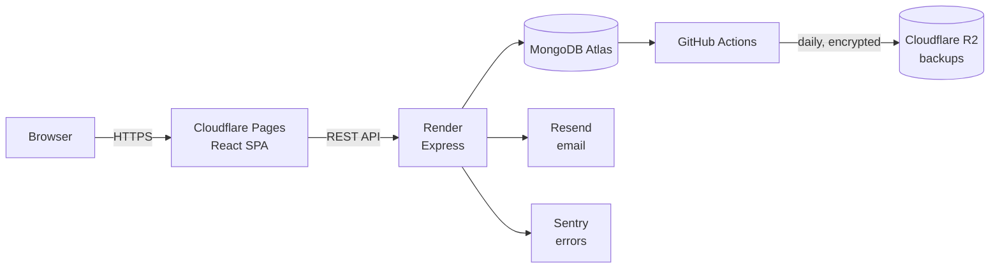

# Jergario

> 🌎 **Jergario is a Spanish-language site**, made for Spanish speakers: a collaborative dictionary of slang from all of Latin America and Spain. This README is in English because it presents the project as part of my portfolio.
>
> 🇪🇸 **Jergario es un sitio en español**, hecho para el público hispanohablante: un diccionario colaborativo de jerga de toda Latinoamérica y España. Este README está en inglés porque presenta el proyecto como parte de mi portfolio.

**A collaborative dictionary of Spanish slang, with regional variants for every Spanish-speaking country.** Anyone can look up what a word means *where they live*; registered users define words, vote, comment, and flag which countries use each definition.

🔗 **Live:** [jergario.com](https://jergario.com) &nbsp;·&nbsp; 💻 **Source code:** private; available on request for interviews.

<!-- Screenshots: add them to screenshots/ (desktop and mobile, light and dark) -->
| Word page | Mobile | Year in review ("Rewind") | Admin stats |
|---|---|---|---|
|  |  |  |  |

---

## What it does

- **Words with regional meaning.** The same word can mean different things in Argentina and Mexico; every definition carries the countries where it's used, and readers can filter by country.
- **Community moderation.** Reports, a moderation panel, four suspension levels, appeal notices, and a full sanctions history.
- **Reputation ("Verba").** Points for definitions and upvotes, backed by an event log, so the total can always be recomputed and audited.
- **Accounts done properly.** Email verification, password reset, login with email or username, Google sign-in, optional two-factor authentication (required for moderators), "remember this device", username and email changes with confirmation, account deletion with a 30-day grace period, and a one-click export of all your data.
- **Statistics.** An admin dashboard (usage, retention, funnel, content, searches, community, moderation, traffic) with Excel, CSV and JSON export, plus personal stats for every user.
- **Year in review.** A Spotify-Wrapped-style "Rewind": full-screen stories and a shareable image drawn with Canvas.

## Stack

| Layer | Technology |
|---|---|
| Frontend | React 19, Vite, Tailwind CSS, React Router, Recharts |
| Backend | Node.js, Express 5, Mongoose |
| Database | MongoDB Atlas |
| Auth | JWT, bcrypt, Google Identity Services, TOTP 2FA (`otplib`) |
| Infrastructure | Cloudflare Pages (web), Render (API), Cloudflare (domain, backups), Resend (email), Sentry (errors) |

## Engineering highlights

- **572 automated API checks** across 30 suites: each suite boots a fresh server against a development database, and a guard makes them refuse to run anywhere else.
- **Security by design.** Passwords with bcrypt (cost 12, upgraded transparently on login); random tokens stored as SHA-256; low-entropy values (banned emails, recovery codes) as HMAC with a server-side pepper; 2FA secrets encrypted with AES-256-GCM; rate limits that count only failed logins; NoSQL-injection and ReDoS protection; generic 500s that never leak internals.
- **Privacy built in.** Page views are de-duplicated with an hourly, irreversible hash (IP addresses are never stored); searches are logged without the user; retention limits enforced by TTL indexes; GDPR / Argentine data-protection rights implemented in the product, not just promised in a policy.
- **Data integrity.** Votes in their own collection with atomic, conditional updates (no double-click races); schema validation as a second line of defense; an integrity checker that also warns when encryption keys stop matching the stored secrets.
- **Spanish-aware search.** Words are matched ignoring case and accents but keeping the "ñ" ("año" ≠ "ano"); acronyms and words share a page; definitions link to other words automatically, with Unicode-aware word boundaries.
- **SEO for a single-page app.** Canonical URLs, per-word descriptions that name the countries, schema.org structured data (escaped against script injection), a generated sitemap, and `noindex` for private pages.
- **Documented decisions.** Every significant choice is recorded with its reasoning, from the database redesign to the backup strategy.

## Status

Live and being filled with real slang by its first users. A mobile app (React Native) is planned on the same API.

---

> 🌎 **Remember: Jergario is for Spanish speakers.** The site, the definitions and the community are in Spanish. If you speak Spanish, [come in and define the slang from where you live](https://jergario.com).
>
> 🇪🇸 **Recordá: Jergario es para hispanohablantes.** El sitio, las definiciones y la comunidad están en español. Si hablás español, [entrá y definí la jerga de tu lugar](https://jergario.com).
